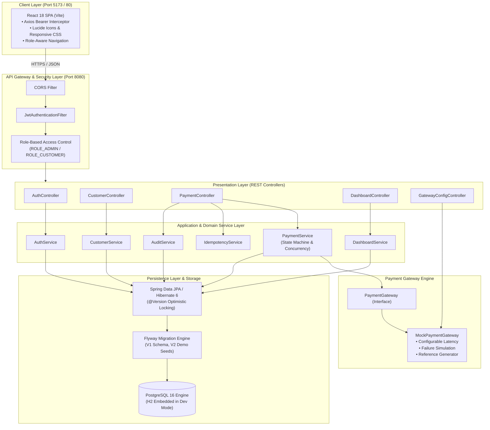

# PayFlow: Full-Stack Payment Processing & Transaction Management Platform

[](https://openjdk.org/)
[](https://spring.io/projects/spring-boot)
[](https://www.postgresql.org/)
[](https://react.dev/)
[](https://vitejs.dev/)
[](https://www.docker.com/)
[](#testing)
[](LICENSE)

> **Enterprise-grade, educational fintech simulation platform** engineering real-world payment lifecycles, distributed idempotency, optimistic concurrency control, transaction boundaries, JWT role-based security, and audit observability.

---

## 1. Project Overview & Problem Statement

### The Real-World Challenge
In commercial financial technology and payment gateways (e.g., Stripe, Adyen, PayPal), distributed systems operate across unreliable networks. Network drops, client timeouts, accidental double-clicks, and concurrent worker threads introduce critical failure modes:
1. **Double Charging:** A customer taps "Pay Now", the connection drops before receiving the response, and the customer taps "Pay Now" again. Without strict idempotency, two distinct charges are executed.
2. **Lost Updates & Race Conditions:** Two background worker processes attempt to update a payment status (e.g., gateway webhook arrival vs. user-initiated cancellation) concurrently, overwriting one another without conflict detection.
3. **Invalid State Transitions:** A payment already marked `SUCCESS` should never transition to `FAILED` or `CANCELLED`. Inconsistent state machines can cause unauthorized chargebacks or lost inventory.
4. **Audit Trail Deficits:** Financial compliance (SOX, PCI-DSS) mandates an immutable record of every payment state transition, gateway communication attempt, and administrative intervention.

### How PayFlow Solves This
**PayFlow** is built from the ground up as a production-grade blueprint solving these fundamental financial engineering challenges:
- **Strict Idempotency Guard:** Eliminates duplicate charges across network retries via client-provided idempotency keys, enforced at both the service layer and through a database-level unique constraint (`uq_payments_idempotency`).
- **Optimistic Concurrency Control:** Implements `@Version` counters on all payment entities, throwing `ObjectOptimisticLockingFailureException` (HTTP 409 Conflict) upon concurrent mutation attempts.
- **Strict Finite State Machine (FSM):** All state changes pass through `PaymentStatus.canTransitionTo()`. Terminal states (`SUCCESS`, `CANCELLED`) are permanently immutable.
- **ACID Transaction Boundaries:** `@Transactional(isolation = Isolation.READ_COMMITTED)` ensures payment creation, status changes, attempt recording, and audit logging succeed atomically or roll back completely.
- **Dual-Mode Mock Payment Gateway:** Provides a realistic payment simulation layer with programmable network latency, deterministically configurable success/failure rates, and explicit failure reason codes.
- **Stateless RBAC Security:** Spring Security 6 filter chain with cryptographic JJWT (HMAC-SHA256) authentication, BCrypt password hashing (work factor 12), and role-based authorization (`ROLE_ADMIN`, `ROLE_CUSTOMER`).
- **Interactive Fintech Dashboard:** Modern React 18 single-page application (SPA) featuring real-time financial metrics, dynamic status badges, customer directories, payment histories, and a live gateway simulation control panel.

> [!IMPORTANT]
> **Educational Financial Simulation Only:** PayFlow does not connect to real banking networks or process real money. It does not store actual Primary Account Numbers (PANs), CVVs, or bank credentials. All payment processing is safely orchestrated via a sandbox mock gateway.

---

## 2. System Architecture

PayFlow follows a clean **Modular Monolith** architecture with strict separation of concerns, structured for seamless future migration toward microservices.



### Layer Responsibilities

| Architectural Layer | Core Responsibility | Key Components |
|---|---|---|
| **Frontend Client** | Responsive UI, client-side routing, JWT session persistence, form validation, and reactive financial dashboards. | React 18, React Router v6, Axios, Lucide React |
| **Security Layer** | Request interception, JWT extraction, cryptographic signature verification, user context loading, and route-level authorization. | `SecurityConfig`, `JwtAuthenticationFilter`, `JwtTokenProvider` |
| **REST Controllers** | Request routing, path parameter deserialization, Jakarta Bean Validation (`@Valid`), and standardized JSON response mapping. | `PaymentController`, `CustomerController`, `AuthController` |
| **Domain Services** | ACID business transactions, payment state machine enforcement, optimistic lock collision recovery, and idempotency guarantees. | `PaymentService`, `IdempotencyService`, `AuditService` |
| **Payment Gateway** | Strategy-pattern interface isolating external PSP communication; sandbox simulator with configurable latency and error injection. | `PaymentGateway`, `MockPaymentGateway` |
| **Persistence Engine** | Fixed-point financial arithmetic (`BigDecimal` / `NUMERIC(15,2)`), relational integrity, version counters, and automated Flyway schema migrations. | Spring Data JPA, PostgreSQL 16, Flyway, H2 |

For in-depth architectural breakdowns, visit:
- 📖 [docs/architecture.md](docs/architecture.md) — Modular Monolith design patterns, DTO boundary mapping, and dependency flow.
- 📖 [docs/system-design.md](docs/system-design.md) — Sequence diagrams, elevator idempotency model, state machine logic, and 10,000 TPS scale roadmap.

---

## 3. Technology Stack

Every component and version in PayFlow is drawn directly from the verified production codebase:

```
PayFlow/
├── backend/    Java 17 LTS • Spring Boot 3.2.5 • PostgreSQL 16 • Flyway • JJWT 0.12.5 • JUnit 5
└── frontend/   React 18.3.1 • Vite 5.2.11 • React Router 6.23.1 • Axios 1.7.2 • Vitest 1.6.0
```

### Backend Technologies
- **Runtime:** Java 17 LTS (Eclipse Temurin)
- **Framework:** Spring Boot 3.2.5
- **Web Layer:** Spring Web MVC (`spring-boot-starter-web`)
- **Persistence:** Spring Data JPA / Hibernate 6 (`spring-boot-starter-data-jpa`)
- **Security:** Spring Security 6 (`spring-boot-starter-security`)
- **Authentication:** JJWT 0.12.5 (`jjwt-api`, `jjwt-impl`, `jjwt-jackson`)
- **Validation:** Jakarta Bean Validation (`spring-boot-starter-validation`)
- **Production Database:** PostgreSQL 16 via official PostgreSQL JDBC Driver
- **Development/Test Database:** H2 Database Engine 2.2.x (in PostgreSQL compatibility mode)
- **Database Migrations:** Flyway Migration Engine (`flyway-core`)
- **API Documentation:** Springdoc OpenAPI Starter 2.5.0 (Swagger UI v5)
- **Unit & Integration Testing:** JUnit 5 (Jupiter), Mockito, Spring Boot Test, Spring Security Test

### Frontend Technologies
- **Core Library:** React 18.3.1
- **Build Tool & Dev Server:** Vite 5.2.11
- **Routing:** React Router DOM 6.23.1
- **HTTP Client:** Axios 1.7.2 (with Bearer interceptors and error handlers)
- **Iconography:** Lucide React 0.378.0
- **Testing Engine:** Vitest 1.6.0, React Testing Library 15.0.7, Happy-DOM 21.0.4

### DevOps & Containerization
- **Container Engine:** Docker Engine & Docker Compose (v3.8 specification)
- **Backend Image:** Multi-stage `maven:3.9.6-eclipse-temurin-17` $\rightarrow$ `eclipse-temurin:17-jre-alpine`
- **Frontend Image:** Multi-stage `node:20-alpine` $\rightarrow$ `nginx:alpine`
- **Database Image:** `postgres:16-alpine`

---

## 4. Installation & Local Setup

PayFlow supports two flexible setup methods:
- **Mode A (Zero-Setup Local Dev):** Runs on your local machine using embedded H2 in PostgreSQL compatibility mode — *no PostgreSQL installation required*.
- **Mode B (Production/Dockerized):** Runs the full multi-tier environment (PostgreSQL 16, Spring Boot backend, and Nginx React frontend) inside Docker Compose.

### Prerequisites

| Tool | Minimum Version | Verification Command |
|---|---|---|
| **Java JDK** | 17 LTS or higher | `java -version` |
| **Apache Maven** | 3.9+ | `mvn -version` |
| **Node.js & npm** | Node 18+ / npm 9+ | `node -v` and `npm -v` |
| **Docker Desktop** *(Optional)* | 24+ | `docker -v` and `docker compose version` |

---

### Mode A: Standalone Local Setup (Recommended for Development)

In this mode, the backend defaults to the `dev` profile. Flyway automatically executes migrations against an in-memory database operating with full PostgreSQL dialect support.

#### Step 1: Clone and Navigate
```powershell
git clone https://github.com/your-username/PayFlow.git
cd PayFlow
```

#### Step 2: Start the Spring Boot Backend
Open a terminal in the `backend/` directory:
```powershell
cd backend
mvn spring-boot:run
```
*Expected Startup Output:*
```
2026-11-21 22:30:00 [main] INFO  com.payflow.PayFlowApplication - Started PayFlowApplication in 3.42 seconds
2026-11-21 22:30:00 [main] INFO  c.p.config.DataInitializer - Initialized default ADMIN user: [username=admin, password=admin123]
2026-11-21 22:30:00 [main] INFO  c.p.config.DataInitializer - Initialized default CUSTOMER user: [username=sarah, password=customer123]
2026-11-21 22:30:00 [main] INFO  c.p.config.DataInitializer - Initialized 5 default customer accounts for transaction testing.
```
- Backend is live at: `http://localhost:8080`
- Swagger UI documentation: `http://localhost:8080/swagger-ui.html`
- In-memory H2 DB Console: `http://localhost:8080/h2-console` (JDBC URL: `jdbc:h2:mem:payflow_db`, User: `sa`, Password: *(leave blank)*)

#### Step 3: Start the React Frontend
Open a separate terminal in the `frontend/` directory:
```powershell
cd frontend
npm install
npm run dev
```
*Expected Output:*
```
  VITE v5.2.11  ready in 250 ms

  ➜  Local:   http://localhost:5173/
  ➜  Network: use --host to expose
```
- Open `http://localhost:5173` in your browser to access the PayFlow portal.

---

### Mode B: Full Stack Deployment via Docker Compose

Run the entire system in isolated containers backed by a persistent PostgreSQL 16 database.

#### Step 1: Configure Environment Variables
Copy the template configuration into `.env`:
```powershell
# From the PayFlow root directory
Copy-Item .env.example .env
```

#### Step 2: Build and Run Containers
```powershell
docker compose up --build -d
```

#### Step 3: Verify Running Services
```powershell
docker compose ps
```
*Expected Container Status:*
```
NAME               IMAGE                   STATUS                   PORTS
payflow-postgres   postgres:16-alpine      Up (healthy)             0.0.0.0:5432->5432/tcp
payflow-backend    payflow-backend:latest  Up (healthy)             0.0.0.0:8080->8080/tcp
payflow-frontend   payflow-frontend:latest Up                       0.0.0.0:5173->80/tcp
```

#### Step 4: Access the Applications
- **Web Frontend:** `http://localhost:5173`
- **REST Backend & APIs:** `http://localhost:8080`
- **Swagger Documentation:** `http://localhost:8080/swagger-ui.html`

To view logs or stop the environment:
```powershell
# Tail live backend logs
docker compose logs -f backend

# Stop and tear down containers
docker compose down

# Stop and wipe database volume (clean reset)
docker compose down -v
```

---

## 5. Seeded Demo Accounts

PayFlow automatically bootstraps two role-based user accounts and five customer profiles upon initial launch to enable immediate manual and automated testing.

> [!CAUTION]
> **DEVELOPMENT / DEMO CREDENTIALS ONLY**
> The accounts listed below are seeded automatically by `DataInitializer.java` and `V2__seed_demo_data.sql` for evaluation and testing. Before deploying to any public or production environment:
> 1. Disable `DataInitializer` or restrict it via `@Profile("!prod")`.
> 2. Rotate all passwords using `BCryptPasswordEncoder`.
> 3. Generate a cryptographically secure 256-bit `JWT_SECRET` via `openssl rand -hex 32` and provide it via environment variables.

| Username | Demo Password | Role | Permissions & Scope |
|---|---|---|---|
| `admin` | `admin123` | `ROLE_ADMIN` | • Full system administration<br>• Create, update, activate & deactivate customers<br>• View all payments and audit logs<br>• Modify mock gateway simulation parameters |
| `sarah` | `customer123` | `ROLE_CUSTOMER` | • Access customer portal<br>• View own payment history<br>• Create and initiate new payment requests |

### Seeded Customer Accounts (For Payment Testing)

| Customer ID | Name | Email | Initial Status |
|---|---|---|---|
| `1` | Sarah Jenkins | `sarah.jenkins@acme.com` | `ACTIVE` |
| `2` | Alex Mercer | `alex.mercer@fintechlab.io` | `ACTIVE` |
| `3` | Elena Rostova | `elena.rostova@cloudscale.net` | `ACTIVE` |
| `4` | David Chen | `david.chen@nexuspay.org` | `INACTIVE` *(Used to test rejection of payments from inactive accounts)* |
| `5` | Marcus Vance | `marcus.vance@vanguard.co` | `ACTIVE` |

---

## 6. REST API Overview & Verified Examples

All endpoints (except registration and login) require a standard HTTP header containing the Bearer token:
```http
Authorization: Bearer <jwt-token>
```

### Endpoint Summary Table

| Category | HTTP Method | Endpoint Path | Description | Access |
|---|---|---|---|---|
| **Auth** | `POST` | `/api/v1/auth/register` | Register a new user account | Public |
| **Auth** | `POST` | `/api/v1/auth/login` | Authenticate and obtain JWT token | Public |
| **Auth** | `GET` | `/api/v1/auth/me` | Fetch authenticated user profile | Authenticated |
| **Customers** | `POST` | `/api/v1/customers` | Register a new customer record | Admin |
| **Customers** | `GET` | `/api/v1/customers` | List customers (paginated & searchable) | Authenticated |
| **Customers** | `GET` | `/api/v1/customers/{id}` | Get customer details by ID | Authenticated |
| **Customers** | `PUT` | `/api/v1/customers/{id}` | Update customer name/email/phone | Admin |
| **Customers** | `PATCH` | `/api/v1/customers/{id}/status` | Activate or deactivate customer | Admin |
| **Payments** | `POST` | `/api/v1/payments` | Create & process idempotent payment | Authenticated |
| **Payments** | `GET` | `/api/v1/payments` | List payments (status/date filterable) | Authenticated |
| **Payments** | `GET` | `/api/v1/payments/{id}` | Get full payment detail & attempts | Authenticated |
| **Payments** | `GET` | `/api/v1/payments/customer/{id}` | Get customer payment history | Authenticated |
| **Payments** | `POST` | `/api/v1/payments/{id}/retry` | Retry an eligible `FAILED` payment | Authenticated |
| **Payments** | `POST` | `/api/v1/payments/{id}/cancel` | Cancel an eligible `PENDING` payment | Authenticated |
| **Dashboard** | `GET` | `/api/v1/dashboard/summary` | Aggregate metrics (volume, rates, counts) | Authenticated |
| **Dashboard** | `GET` | `/api/v1/dashboard/trends` | 7-day payment volume trend lines | Authenticated |
| **Gateway** | `GET` | `/api/v1/gateway/config` | Read mock gateway latency & failure rate | Admin |
| **Gateway** | `PUT` | `/api/v1/gateway/config` | Update gateway simulation parameters | Admin |

---

### Verified `curl` Workflow Examples

#### 1. Authenticate & Obtain Token
```powershell
curl -X POST http://localhost:8080/api/v1/auth/login `
  -H "Content-Type: application/json" `
  -d '{"username": "admin", "password": "admin123"}'
```
*Response (`200 OK`):*
```json
{
  "token": "eyJhbGciOiJIUzI1NiJ9.eyJzdWIiOiJhZG1pbiIsImlhdCI6MTczMjIwMDAwMCwiZXhwIjoxNzMyMjg2NDAwfQ...",
  "type": "Bearer",
  "username": "admin",
  "email": "admin@payflow.internal",
  "role": "ADMIN"
}
```

#### 2. Create an Idempotent Payment
Set your shell variable with the token from Step 1:
```powershell
$TOKEN = "eyJhbGciOiJIUzI1NiJ9..."

curl -X POST http://localhost:8080/api/v1/payments `
  -H "Authorization: Bearer $TOKEN" `
  -H "Content-Type: application/json" `
  -d '{
    "customerId": 1,
    "amount": 249.99,
    "currency": "USD",
    "description": "Enterprise SaaS Subscription",
    "paymentMethodType": "MOCK_CARD",
    "idempotencyKey": "order-inv-98214"
  }'
```
*Response (`201 Created`):*
```json
{
  "id": 1,
  "customerId": 1,
  "customerName": "Sarah Jenkins",
  "amount": 249.99,
  "currency": "USD",
  "description": "Enterprise SaaS Subscription",
  "status": "SUCCESS",
  "paymentMethodType": "MOCK_CARD",
  "idempotencyKey": "order-inv-98214",
  "gatewayTransactionRef": "MOCK-TXN-1732201948123-5819",
  "failureReason": null,
  "createdAt": "2026-11-21T22:30:48.123",
  "updatedAt": "2026-11-21T22:30:48.273"
}
```

#### 3. Verify Idempotency Protection (Re-submitting the exact request)
Run the exact same command above a second time with the same `idempotencyKey`. The backend immediately detects the existing transaction, skips re-charging through the gateway, and returns the original transaction record (`200 OK`) without incrementing attempt counts.

#### 4. Fetch Aggregate Dashboard Metrics
```powershell
curl -X GET http://localhost:8080/api/v1/dashboard/summary `
  -H "Authorization: Bearer $TOKEN"
```
*Response (`200 OK`):*
```json
{
  "totalVolume": 18450.50,
  "totalTransactions": 48,
  "successfulTransactions": 45,
  "failedTransactions": 3,
  "successRate": 93.75,
  "activeCustomers": 4
}
```

Full request/response schemas and HTTP error codes are detailed in:
- 📖 [docs/api-documentation.md](docs/api-documentation.md) — Comprehensive API specifications and error contracts.
- 🌐 [Swagger UI Interactive Explorer](http://localhost:8080/swagger-ui.html) *(Available when backend is running).*

---

## 7. Testing & Quality Assurance

PayFlow enforces automated test coverage across both the Spring Boot backend and the React frontend.

```
Total Test Suite: 38 Passing Tests
├── Backend Suite:  30 Tests (JUnit 5 + Mockito + MockMvc) • 100% Passing
└── Frontend Suite:  8 Tests (Vitest + React Testing Library) • 100% Passing
```

### Running Backend Tests
Execute the entire test suite using Maven from the `backend/` directory:
```powershell
cd backend
mvn test
```

To run a specific test class:
```powershell
# Run Payment Service business logic tests
mvn test -Dtest=PaymentServiceTest

# Run Customer Controller REST integration tests
mvn test -Dtest=CustomerControllerIntegrationTest
```

### Running Frontend Tests
Execute the Vitest component tests from the `frontend/` directory:
```powershell
cd frontend
npm test
```

To run frontend tests in interactive watch mode:
```powershell
npx vitest
```

### Running Production Builds

#### Backend JAR Build
```powershell
cd backend
mvn clean package -DskipTests
```
*Build Artifact:* `backend/target/payflow-backend-1.0.0.jar` (Executable Spring Boot fat JAR with embedded Tomcat).

#### Frontend Static SPA Build
```powershell
cd frontend
npm run build
```
*Build Artifact:* `frontend/dist/` (Optimized, tree-shaken static assets ready for deployment behind Nginx, Cloudflare Pages, or AWS S3).

For complete details on test scenarios and slice testing strategies:
- 📖 [docs/testing.md](docs/testing.md) — Testing pyramid, Mockito verifications, and test catalogs.

---

## 8. Technical Documentation Index

PayFlow includes a comprehensive technical documentation suite designed to guide engineering onboarding and technical interview preparation:

| Document | Primary Audience | Description |
|---|---|---|
| 📑 [docs/architecture.md](docs/architecture.md) | Architects & Engineers | Modular monolith structure, layer boundaries, DTO mapping strategies, and dependency flows. |
| 📑 [docs/database-design.md](docs/database-design.md) | Database Designers & DBAs | Entity relationships, PostgreSQL data dictionary, indexing, `@Version` optimistic locking, and Flyway lifecycle. |
| 📑 [docs/api-documentation.md](docs/api-documentation.md) | Frontend & Integration Devs | REST API contract, request/response DTO schemas, query parameters, and standardized error payloads. |
| 📑 [docs/system-design.md](docs/system-design.md) | System Design Interviewees | Sequence diagrams, payment state machine, idempotency mechanisms, and high-throughput scalability (10k TPS). |
| 📑 [docs/security.md](docs/security.md) | Security Engineers & DevOps | Spring Security 6 filter chain, JJWT authentication anatomy, BCrypt work factor, and PCI-DSS compliance simulation. |
| 📑 [docs/testing.md](docs/testing.md) | QA & Test Automation | Testing pyramid, H2 PostgreSQL-mode isolation rationale, complete backend/frontend test catalogs, and execution commands. |
| 📑 [docs/learning-guide.md](docs/learning-guide.md) | Students & SDE Candidates | 20 progressive lessons with direct source code references, conceptual deep dives, hands-on exercises, and 10 SDE interview Q&As. |

---

## 9. Troubleshooting & FAQ

### 1. PostgreSQL Connection Error (`Connection to localhost:5432 refused`)
- **Cause:** Local PostgreSQL service is not running or credentials in `application-prod.properties` mismatch.
- **Solution:** 
  1. If running locally without Docker, simply switch to the default `dev` profile (`spring.profiles.active=dev` in `application.properties`), which requires zero setup and boots using the built-in H2 PostgreSQL-compatible engine.
  2. If using Docker, ensure the postgres container is healthy:
     ```powershell
     docker compose ps payflow-postgres
     docker compose logs postgres
     ```
  3. If running a local Windows PostgreSQL service, verify the service status:
     ```powershell
     Get-Service postgresql*
     Start-Service postgresql-x64-16
     ```

### 2. Port Conflicts (Port `8080` or `5173` already occupied)
- **Cause:** A previous instance or other application is bound to port 8080 or 5173.
- **Solution (Windows PowerShell):**
  Find the Process ID (PID) occupying the port and terminate it:
  ```powershell
  # Find PID occupying port 8080
  netstat -ano | findstr :8080
  # Stop the process (replace <PID> with the actual number)
  Stop-Process -Id <PID> -Force
  ```
  Alternatively, override the backend port at launch:
  ```powershell
  mvn spring-boot:run -Dspring-boot.run.arguments="--server.port=8081"
  ```

### 3. Flyway Migration Checksum Mismatch
- **Cause:** A migration script in `src/main/resources/db/migration/` was modified after being applied to the database.
- **Solution:** In local development, wipe the dev database schema for a clean re-migration:
  - If using Docker: `docker compose down -v && docker compose up --build -d`
  - If using embedded H2: simply restart the Spring Boot process (in-memory state resets automatically).

### 4. PowerShell Execution Policy Restriction on `npm` or `mvn`
- **Cause:** Windows restricts script execution by default (`File ... cannot be loaded because running scripts is disabled on this system`).
- **Solution:** Open PowerShell as Administrator and enable local script execution:
  ```powershell
  Set-ExecutionPolicy -ExecutionPolicy RemoteSigned -Scope CurrentUser
  ```

---

## 10. License & Contributing

Distributed under the MIT License. See `LICENSE` for more information.

Developed with precision as a comprehensive reference implementation for modern, robust financial software engineering. Contributions, bug reports, and suggestions are welcome via GitHub issues and pull requests.
