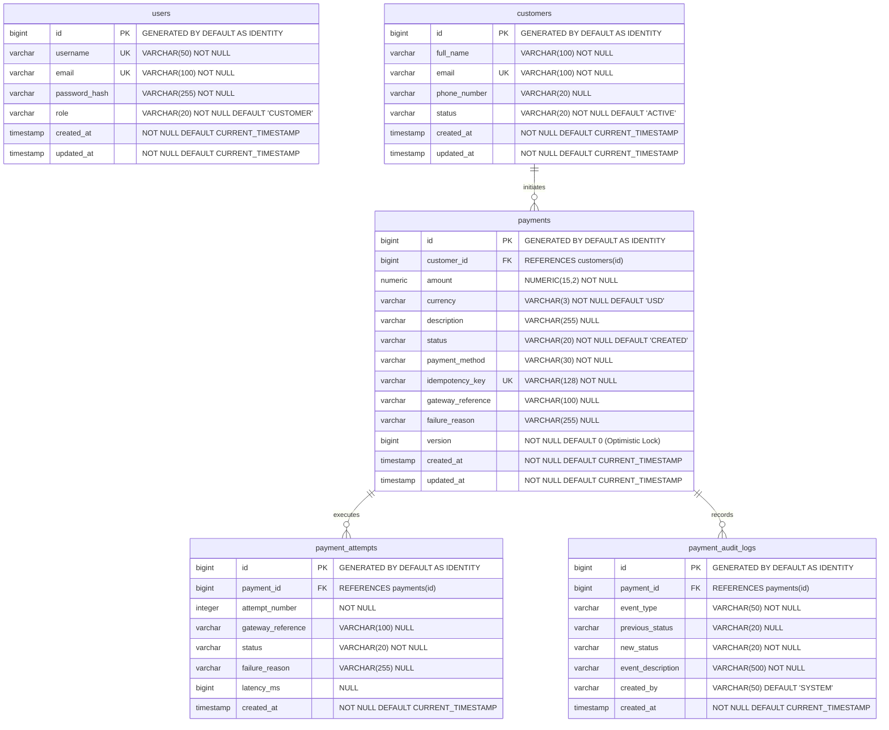

# PayFlow Database Design & Schema Architecture

## 1. Overview

PayFlow utilizes **PostgreSQL** as its production relational database engine, managed through immutable **Flyway schema migrations**. The database schema is designed around core financial engineering requirements:
- **Strict Data Consistency:** Foreign keys, check constraints, and unique constraints prevent corrupt states.
- **Financial Precision:** Absolute elimination of floating-point rounding errors via fixed-point decimal storage (`NUMERIC(15, 2)`).
- **Concurrency Control:** Optimistic locking version counters to prevent lost updates and double-processing race conditions.
- **Auditability:** Dedicated attempt tracking and immutable state-transition audit log tables.
- **Safe Retention:** Prevention of cascade deletion for customers associated with financial history.

---

## 2. Entity-Relationship (ER) Diagram

The following Mermaid entity-relationship diagram illustrates the tables, column specifications, and relational cardinality:



---

## 3. Table Specifications & Column Dictionary

### 3.1 Table: `users`
Stores administrative operators and client users authorized to access the PayFlow platform.

| Column | Type | Constraints | Description |
| :--- | :--- | :--- | :--- |
| `id` | `BIGINT` | `PRIMARY KEY`, Auto-increment | Unique identifier for the user account. |
| `username` | `VARCHAR(50)` | `NOT NULL`, `UNIQUE` | Unique login username (min 3 chars). |
| `email` | `VARCHAR(100)` | `NOT NULL`, `UNIQUE` | Unique email for security verification. |
| `password_hash` | `VARCHAR(255)`| `NOT NULL` | One-way BCrypt hash with salt. Plaintext is never stored. |
| `role` | `VARCHAR(20)` | `NOT NULL`, Default `'CUSTOMER'` | Authorization role (`ADMIN` or `CUSTOMER`). |
| `created_at` | `TIMESTAMP` | `NOT NULL`, Default `NOW()` | Record creation timestamp. |
| `updated_at` | `TIMESTAMP` | `NOT NULL`, Default `NOW()` | Last modification timestamp. |

---

### 3.2 Table: `customers`
Stores verified customer profiles who send or receive money within the payment platform.

| Column | Type | Constraints | Description |
| :--- | :--- | :--- | :--- |
| `id` | `BIGINT` | `PRIMARY KEY`, Auto-increment | Unique customer account number. |
| `full_name` | `VARCHAR(100)`| `NOT NULL` | Customer's legal name or business title. |
| `email` | `VARCHAR(100)`| `NOT NULL`, `UNIQUE` | Customer contact email; checked for duplicates. |
| `phone_number`| `VARCHAR(20)` | `NULL` | Optional international contact number. |
| `status` | `VARCHAR(20)` | `NOT NULL`, Default `'ACTIVE'` | Account state: `ACTIVE`, `INACTIVE`, or `SUSPENDED`. |
| `created_at` | `TIMESTAMP` | `NOT NULL`, Default `NOW()` | Registration timestamp. |
| `updated_at` | `TIMESTAMP` | `NOT NULL`, Default `NOW()` | Profile update timestamp. |

> **Business Rule:** Only customers with status `ACTIVE` can initiate transactions. Deactivating a customer halts payment initiation immediately without deleting their audit history.

---

### 3.3 Table: `payments`
The core ledger table tracking the state machine, amount, and gateway outcome of every transaction.

| Column | Type | Constraints | Description |
| :--- | :--- | :--- | :--- |
| `id` | `BIGINT` | `PRIMARY KEY`, Auto-increment | Primary ledger transaction ID. |
| `customer_id` | `BIGINT` | `NOT NULL`, `FK -> customers(id)` | Customer who authorized the transaction. |
| `amount` | `NUMERIC(15,2)`| `NOT NULL`, Check `amount > 0` | Monetary value with fixed 2-decimal scale. |
| `currency` | `VARCHAR(3)` | `NOT NULL`, Default `'USD'` | 3-letter ISO-4217 currency code. |
| `description` | `VARCHAR(255)`| `NULL` | Human-readable memo or order description. |
| `status` | `VARCHAR(20)` | `NOT NULL`, Default `'CREATED'` | State: `CREATED`, `PENDING`, `SUCCESS`, `FAILED`, `CANCELLED`. |
| `payment_method`| `VARCHAR(30)` | `NOT NULL` | Rail: `MOCK_CARD`, `MOCK_UPI`, or `MOCK_WALLET`. |
| `idempotency_key`| `VARCHAR(128)`| `NOT NULL`, `UNIQUE` | Client-supplied deduplication token. |
| `gateway_reference`| `VARCHAR(100)`| `NULL` | Downstream gateway transaction reference (`pg_tx_...`). |
| `failure_reason`| `VARCHAR(255)`| `NULL` | Error code/message if gateway declined transaction. |
| `version` | `BIGINT` | `NOT NULL`, Default `0` | JPA `@Version` counter for optimistic locking. |
| `created_at` | `TIMESTAMP` | `NOT NULL`, Default `NOW()` | Submission timestamp. |
| `updated_at` | `TIMESTAMP` | `NOT NULL`, Default `NOW()` | State change timestamp. |

---

### 3.4 Table: `payment_attempts`
Tracks every discrete attempt dispatched to a payment gateway. When a failed payment is retried, a new attempt record is inserted with an incremented attempt number.

| Column | Type | Constraints | Description |
| :--- | :--- | :--- | :--- |
| `id` | `BIGINT` | `PRIMARY KEY`, Auto-increment | Attempt log ID. |
| `payment_id` | `BIGINT` | `NOT NULL`, `FK -> payments(id)` | Parent payment transaction. |
| `attempt_number`| `INTEGER` | `NOT NULL` | Sequence number (1 for first try, 2 for retry, etc.). |
| `gateway_reference`| `VARCHAR(100)`| `NULL` | Unique reference returned by gateway for this try. |
| `status` | `VARCHAR(20)` | `NOT NULL` | Result: `SUCCESS`, `FAILED`, or `PENDING`. |
| `failure_reason`| `VARCHAR(255)`| `NULL` | Upstream decline reason for this attempt. |
| `latency_ms` | `BIGINT` | `NULL` | Gateway roundtrip latency in milliseconds. |
| `created_at` | `TIMESTAMP` | `NOT NULL`, Default `NOW()` | Attempt initiation timestamp. |

---

### 3.5 Table: `payment_audit_logs`
An append-only immutable audit trail recording every state change and user action.

| Column | Type | Constraints | Description |
| :--- | :--- | :--- | :--- |
| `id` | `BIGINT` | `PRIMARY KEY`, Auto-increment | Audit log entry ID. |
| `payment_id` | `BIGINT` | `NOT NULL`, `FK -> payments(id)` | Associated payment transaction. |
| `event_type` | `VARCHAR(50)` | `NOT NULL` | `PAYMENT_CREATED`, `PAYMENT_PROCESSING_STARTED`, `PAYMENT_SUCCEEDED`, `PAYMENT_FAILED`, `PAYMENT_RETRIED`, `PAYMENT_CANCELLED`. |
| `previous_status`| `VARCHAR(20)`| `NULL` | State before transition (e.g. `PENDING`). |
| `new_status` | `VARCHAR(20)` | `NOT NULL` | State after transition (e.g. `SUCCESS`). |
| `event_description`| `VARCHAR(500)`| `NOT NULL` | Detailed explanation of event and gateway result. |
| `created_by` | `VARCHAR(50)` | Default `'SYSTEM'` | Principal username or system worker that triggered the event. |
| `created_at` | `TIMESTAMP` | `NOT NULL`, Default `NOW()` | Exact wall-clock timestamp of event. |

---

## 4. Monetary Precision: Why `NUMERIC(15, 2)` / `BigDecimal`

### The Floating-Point Problem
In computer systems, standard floating-point types (`float` and `double` in Java, `REAL` or `DOUBLE PRECISION` in SQL) represent numbers using IEEE 754 binary fractions ($1/2, 1/4, 1/8$). Most base-10 decimals cannot be represented exactly in binary:
$$\frac{1}{10} = 0.1_{10} = 0.0001100110011..._2$$

In Java:
```java
// Danger: Floating point arithmetic
double a = 0.1;
double b = 0.2;
System.out.println(a + b); // Prints: 0.30000000000000004
```
Over thousands of transactions, accumulating binary rounding errors leads to ledger discrepancies, accounting failures, and compliance violations.

### The PayFlow Solution
- **In SQL:** `NUMERIC(15, 2)` stores exact fixed-point decimals with up to 13 digits before the decimal point and exactly 2 decimal places.
- **In Java:** `java.math.BigDecimal` is used across all entities, DTOs, and services with explicit rounding modes:
```java
payment.getAmount().setScale(2, RoundingMode.HALF_UP);
```

---

## 5. Constraint & Referential Integrity Rules

1. **Foreign Key Cascade Policy:**
   - `payments -> customers(id)` does **NOT** use `ON DELETE CASCADE`.
   - If an operator attempts to delete a customer who has existing transactions, PostgreSQL blocks the operation with a Foreign Key Violation (`DataIntegrityViolationException`).
   - The application layer (`CustomerService.java`) checks `paymentRepository.existsByCustomerId(id)` and throws a descriptive error instructing the operator to mark the customer as `INACTIVE` instead.
2. **Idempotency Key Uniqueness:**
   - `payments.idempotency_key` has a hard `UNIQUE` database constraint (`idx_payments_idempotency`).
   - Even if two identical requests bypass application-level checks under high concurrency, the database guarantees that only one transaction insert can commit. The duplicate transaction triggers a unique constraint collision caught by `GlobalExceptionHandler`.
3. **Optimistic Locking Guard:**
   - The `version` column prevents lost updates. When reading a payment in state `FAILED` for retry, Hibernate issues:
   ```sql
   UPDATE payments SET status = 'PENDING', version = version + 1
   WHERE id = ? AND version = ?;
   ```
   If another thread modified the payment concurrently, the version check fails ($0$ rows updated), throwing an `ObjectOptimisticLockingFailureException`.

---

## 6. Indexing & Query Optimization Strategy

PayFlow includes dedicated B-Tree indexes aligned with high-frequency read patterns:

| Index Name | Target Table & Columns | Optimized Query Pattern |
| :--- | :--- | :--- |
| `idx_payments_idempotency` | `payments(idempotency_key)` | $O(\log N)$ lookup during payment creation deduplication check. |
| `idx_payments_customer_id` | `payments(customer_id)` | Fast retrieval of a customer's payment history (`/api/customers/{id}/payments`). |
| `idx_payments_status` | `payments(status)` | Filtering payments by status in console and dashboard aggregations (`countByStatus`, `sumAmountByStatus`). |
| `idx_payments_created_at` | `payments(created_at)` | Range scans for dashboard payment trends (`findPaymentsSince`) and date-filtered queries. |
| `idx_customers_email` | `customers(email)` | Instant duplicate email validation upon customer registration. |
| `idx_customers_status` | `customers(status)` | Filtering active/inactive accounts in customer list. |
| `idx_payment_attempts_payment_id` | `payment_attempts(payment_id)` | Loading all gateway attempts for transaction detail view. |
| `idx_audit_logs_payment_id` | `payment_audit_logs(payment_id)` | Retrieving chronological event timelines (`/api/payments/{id}/history`). |

---

## 7. Database Migrations (Flyway)

PayFlow uses **Flyway** to ensure schema changes are deterministic, versioned, and reproducible across local development, CI/CD pipelines, and production container environments.

- **Location:** `backend/src/main/resources/db/migration/`
- **Migration Files:**
  1. `V1__init_schema.sql`:
     - Creates tables (`users`, `customers`, `payments`, `payment_attempts`, `payment_audit_logs`).
     - Establishes primary keys, foreign keys, unique constraints, and B-Tree indexes.
     - Uses standard SQL (`BIGINT GENERATED BY DEFAULT AS IDENTITY PRIMARY KEY`) compatible with both PostgreSQL and H2.
  2. `V2__seed_demo_data.sql`:
     - Seeds baseline demo users (`admin` with role `ADMIN`, `sarah` with role `CUSTOMER`).
     - Seeds 5 sample customers across `ACTIVE` and `INACTIVE` statuses.
     - Seeds sample payments with associated gateway attempts and audit logs to demonstrate completed, failed, and pending states.

### Flyway Execution Lifecycle
1. On application startup, Flyway checks the `flyway_schema_history` table.
2. If migrations are missing or new versions exist, Flyway executes them inside an atomic transaction.
3. The JPA entity manager validates the schema against entity mappings (`spring.jpa.hibernate.ddl-auto=validate`), ensuring zero schema drift.
