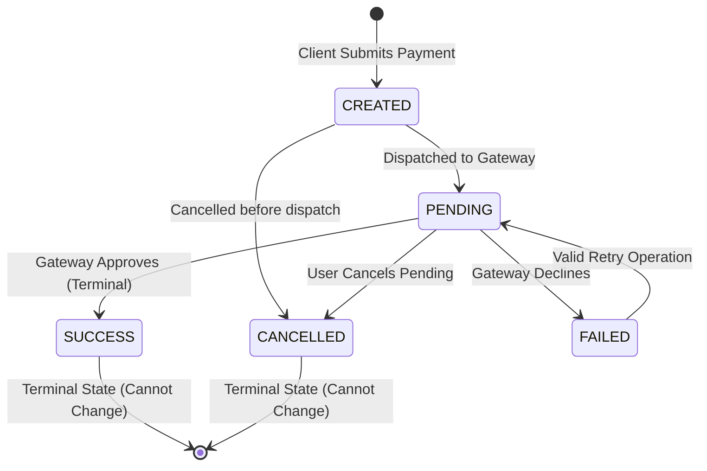

# PayFlow System Design & Architecture Deep Dive

## 1. System Overview

PayFlow is designed to model the exact reliability, concurrency, and consistency guarantees demanded by real-world financial transaction platforms (such as Stripe, Adyen, and PayPal). Financial systems operate under unique constraints:
- **Zero Double Charging:** A user or network retry must never result in multiple deductions.
- **Strict State Machines:** Transactions must follow deterministic, irreversible lifecycles.
- **Auditability:** Every transition, attempt, and latency metric must be durably recorded.
- **High Concurrency:** The platform must prevent race conditions without deadlocking the database.

---

## 2. Payment Request Lifecycle

The diagram below illustrates the exact end-to-end lifecycle of a payment request in PayFlow, from client submission to database persistence:

```mermaid
sequenceDiagram
    autonumber
    actor Client as Client / Frontend
    participant Filter as Security Filter (JWT)
    participant Ctrl as PaymentController
    participant Idem as IdempotencyService
    participant PaySvc as PaymentService
    participant DB as PostgreSQL Database
    participant GW as MockPaymentGateway
    participant Audit as AuditService

    Client->>Filter: POST /api/payments (Idempotency-Key: K, Payload)
    Filter->>Ctrl: Authenticated Principal (User)
    Ctrl->>PaySvc: createAndProcessPayment(request, key, user)

    %% Step 1: Idempotency Verification
    PaySvc->>Idem: checkIdempotency(key, request)
    Idem->>DB: SELECT * FROM payments WHERE idempotency_key = K
    alt Key already exists with IDENTICAL payload
        DB-->>Idem: Existing Payment Record
        Idem-->>PaySvc: Return Existing Payment (Idempotent Replay)
        PaySvc-->>Ctrl: PaymentResponse (Existing Record)
        Ctrl-->>Client: 201 Created (Cached/Replayed result)
    else Key exists with DIFFERENT payload
        Idem-->>PaySvc: Throw IdempotencyConflictException
        PaySvc-->>Ctrl: Exception caught by GlobalExceptionHandler
        Ctrl-->>Client: 409 Conflict (Parameter Mismatch)
    else Key does not exist
        Idem-->>PaySvc: Optional.empty() (Proceed with new transaction)
    end

    %% Step 2: Customer Validation
    PaySvc->>DB: SELECT * FROM customers WHERE id = ?
    alt Customer is INACTIVE or missing
        PaySvc-->>Client: 400 Bad Request (InactiveCustomerException)
    end

    %% Step 3: Record Initialization (Atomic State)
    PaySvc->>DB: INSERT INTO payments (status='CREATED', ...)
    PaySvc->>Audit: recordAuditLog(PAYMENT_CREATED, null -> CREATED)
    Audit->>DB: INSERT INTO payment_audit_logs (...)

    %% Step 4: Dispatch to PENDING
    PaySvc->>DB: UPDATE payments SET status='PENDING'
    PaySvc->>Audit: recordAuditLog(PAYMENT_PROCESSING_STARTED, CREATED -> PENDING)
    Audit->>DB: INSERT INTO payment_audit_logs (...)

    %% Step 5: Gateway Simulation Execution
    PaySvc->>GW: processPayment(GatewayRequest)
    Note over GW: Simulates network latency (150ms),<br/>checks velocity limits, evaluates mock flags
    GW-->>PaySvc: PaymentGatewayResult (success/fail, ref, latency)

    %% Step 6: Log Attempt & Settle State
    PaySvc->>DB: INSERT INTO payment_attempts (status, ref, latency, ...)
    alt Gateway returns SUCCESS
        PaySvc->>DB: UPDATE payments SET status='SUCCESS', gateway_reference=ref
        PaySvc->>Audit: recordAuditLog(PAYMENT_SUCCEEDED, PENDING -> SUCCESS)
    else Gateway returns FAILURE
        PaySvc->>DB: UPDATE payments SET status='FAILED', failure_reason=reason
        PaySvc->>Audit: recordAuditLog(PAYMENT_FAILED, PENDING -> FAILED)
    end
    Audit->>DB: INSERT INTO payment_audit_logs (...)

    PaySvc-->>Ctrl: PaymentResponse
    Ctrl-->>Client: 201 Created (Settled Result)
```



---

## 3. Idempotency Deep Dive

### What is Idempotency?
In mathematics and computer science, an operation is **idempotent** if applying it multiple times produces the same result as applying it once:
$$f(f(x)) = f(x)$$

In HTTP APIs, `GET`, `PUT`, and `DELETE` are inherently idempotent by specification. `POST` is **not** idempotent by default: sending two `POST /api/payments` requests could charge a customer twice.

### Real-World Analogy: The Elevator Button
When you press an elevator call button, the light turns on and summons the elevator.
- If you press the button once: The elevator comes.
- If you press the button 5 more times impatiently: The elevator still comes only once. It does not dispatch 5 separate elevators to your floor.
The elevator call button is **idempotent**.

### How PayFlow Implements Idempotency
1. **Client Identification:** The client generates a unique UUID (e.g. `idem_9a8b7c6d5e4f`) and includes it in the HTTP header:
   ```http
   POST /api/payments
   Idempotency-Key: idem_9a8b7c6d5e4f
   ```
2. **Database Unique Constraint:** The `payments` table defines a hard unique index on `idempotency_key`:
   ```sql
   CONSTRAINT uq_payments_idempotency UNIQUE (idempotency_key)
   ```
3. **Payload Verification:** If an incoming request reuses a key:
   - **Case A (Exact Match):** The payload (customer ID, amount, currency, payment method) matches the existing record. The system returns the existing `PaymentResponse` without calling the payment gateway again.
   - **Case B (Payload Mismatch):** If someone submits the same idempotency key with an altered amount ($\$500$ instead of $\$50$), PayFlow detects the conflict and rejects it with `409 Conflict` (`IdempotencyConflictException`). This prevents malicious payload alteration or unintended key collisions.

---

## 4. Transaction Management & ACID Guarantees

In Spring Boot, `@Transactional` wraps database operations in a database transaction managed by the `PlatformTransactionManager`.

### Why `@Transactional` is Essential for Payments
Consider what happens without transactions if the system crashes midway:
1. `payments` record is created (`status = CREATED`).
2. Gateway settles the charge with the bank.
3. System crashes before updating the database.
**Outcome:** The customer's credit card was charged, but the database shows no successful payment!

With PayFlow's transaction boundary:
- State updates, attempt logging, and audit records are executed within atomic database units.
- Downstream gateway communication is coordinated so that state changes are committed deterministically.

---

## 5. Concurrency Control: Optimistic vs. Pessimistic Locking

When two requests attempt to mutate the same transaction simultaneously (e.g. a user rapidly double-clicking "Retry" or two background workers processing the same queue), concurrency control prevents race conditions.

### Pessimistic Locking (`SELECT ... FOR UPDATE`)
- **Mechanism:** The database locks the selected row until the transaction commits. Other threads must wait in line.
- **Drawbacks:** High database contention, connection pool exhaustion, and potential for deadlocks under heavy load.

### Optimistic Locking (`@Version`) - Selected by PayFlow
- **Mechanism:** Does not acquire physical database locks. Instead, each row maintains an integer/bigint `version` counter:
  ```java
  @Version
  @Column(nullable = false)
  private Long version = 0L;
  ```
- **How It Works:**
  1. Thread A reads payment with `version = 0`.
  2. Thread B reads payment with `version = 0`.
  3. Thread A updates the payment. Hibernate executes:
     ```sql
     UPDATE payments SET status = 'PENDING', version = 1 
     WHERE id = 100 AND version = 0;
     ```
     This succeeds because `version` in the database is $0$.
  4. Thread B now attempts to update the payment:
     ```sql
     UPDATE payments SET status = 'PENDING', version = 1 
     WHERE id = 100 AND version = 0;
     ```
     The database finds **zero rows** matching `version = 0` (since it is now $1$).
  5. Hibernate throws `ObjectOptimisticLockingFailureException`.
  6. PayFlow's `GlobalExceptionHandler` intercepts this and returns a clean `409 Conflict`:
     `"The transaction was concurrently modified by another request. Please retry the operation."`

---

## 6. Payment State Machine

The payment lifecycle is governed by an explicit finite state machine enforced by `PaymentStatus.java`:



### Irreversible Transition Rules
- `canTransitionTo(targetStatus)` validates every transition.
- **Rule 1:** A `SUCCESS` payment can **never** transition to `FAILED`, `PENDING`, or `CANCELLED`.
- **Rule 2:** A `CANCELLED` payment can **never** be re-opened.
- **Rule 3:** A `FAILED` payment can only transition to `PENDING` through an explicit retry action that logs a new attempt sequence number.

---

## 7. Payment Gateway Abstraction Pattern

PayFlow decouples the payment service from gateway vendors using the **Strategy Pattern** and the **Dependency Inversion Principle** (SOLID):

```
┌──────────────────────────┐
│      PaymentService      │
└────────────┬─────────────┘
             │ depends on interface
             ▼
┌──────────────────────────┐
│     <<interface>>        │
│     PaymentGateway       │
├──────────────────────────┤
│ + processPayment()       │
│ + getGatewayProviderName()│
└────────────▲─────────────┘
             │ implements
    ┌────────┴────────┬─────────────────┐
    │                 │                 │
┌───┴────────────┐ ┌──┴────────────┐ ┌──┴────────────┐
│   MockPayment  │ │ StripeGateway │ │ AdyenGateway  │
│     Gateway    │ │ (Future Ext)  │ │ (Future Ext)  │
└────────────────┘ └───────────────┘ └───────────────┘
```

Adding a real payment gateway (like Stripe, PayPal, or Adyen) requires **zero modifications** to `PaymentService`. An engineer simply creates a new class implementing `PaymentGateway` and configures Spring's `@Qualifier` or conditional properties.

---

## 8. Current Implementation vs. Future Production Roadmap

To maintain engineering integrity, the table below explicitly delineates what is implemented in PayFlow versus how the system would evolve to handle millions of transactions:

| Capability | PayFlow Current Implementation | Future Distributed Production Architecture |
| :--- | :--- | :--- |
| **Architecture** | High-performance Modular Monolith | Microservices (Auth, Customer, Payment Engine, Ledger) |
| **Communication** | In-process synchronous execution | Event-driven via Apache Kafka or RabbitMQ |
| **Idempotency** | PostgreSQL unique constraint + service check | Redis distributed locks + 2-phase idempotency reservation |
| **Payment Gateways** | `MockPaymentGateway` with latency & decline simulation | Multi-gateway smart routing (Stripe, Adyen, Braintree) |
| **Concurrency** | JPA `@Version` Optimistic Locking | Distributed locks (Redlock / ZooKeeper) + Sharded database |
| **Audit Storage** | Relational `payment_audit_logs` table | Event sourcing (CQRS) + append-only immutable ledger (Kafka) |
| **Resilience** | Spring Exception Translation & Validation | Resilience4j Circuit Breakers, Rate Limiting, Retries |
| **Database** | Single primary PostgreSQL instance | Read replicas, horizontal sharding, connection pooling (PgBouncer) |

---

## 9. Distributed Systems Evolution (Handling 10,000 TPS)

If PayFlow were scaled to handle 10,000 transactions per second (TPS):

### 1. Two-Phase Asynchronous Processing
Instead of holding an open HTTP connection while waiting for the upstream payment gateway:
1. `Client` sends `POST /api/payments`.
2. `Backend` creates payment in `PENDING` state and writes an event to an **Apache Kafka** topic: `payment-initiated-events`.
3. Client immediately receives `202 Accepted` with a payment ID and status URL.
4. Background worker pools consume from Kafka, call the upstream banking network, and publish `payment-settled-events`.
5. Webhooks or WebSockets notify the client when the payment succeeds or fails.

### 2. Transactional Outbox Pattern
To guarantee that database updates and message broker publishes are atomic:
- The payment record and an **Outbox** message are saved in the same PostgreSQL transaction.
- Debezium (Change Data Capture) or a poller reads the outbox table and streams events to Kafka.
- Eliminates dual-write inconsistencies between the database and the message broker.

### 3. Distributed Idempotency via Redis
Before hitting PostgreSQL:
- A distributed lock (`SET payment:idem:{key} NX EX 60`) in Redis guarantees that concurrent duplicate requests are rejected at the edge in less than $2\text{ms}$.
